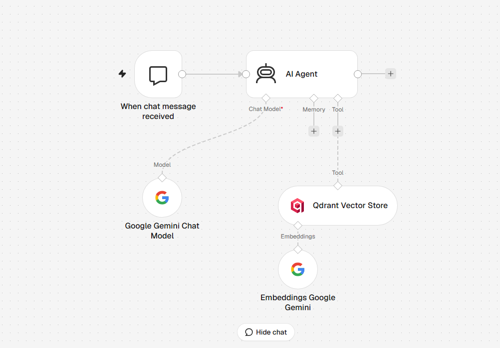

# IKEA Türkiye RAG Chatbot (n8n + Gemini + Qdrant)

A Turkish-language, retrieval-augmented customer information assistant built with **n8n**, **Google Gemini**, and **Qdrant** for the Tech İstanbul Chatbot & Conversational AI Bootcamp (Week 3).

> Educational demonstration; not an official IKEA product or service.

## Architecture

**Indexing:** Manual Trigger → two HTTP Requests (IKEA Türkiye pages) → JavaScript HTML cleaning → Merge → JavaScript character-based chunking → Qdrant Vector Store (insert), with Gemini embeddings and a document loader.

**Chat:** n8n Chat Trigger → AI Agent (Gemini chat model) → Qdrant Vector Store retrieval tool → Turkish answer with source URL or an explicit unknown-information response.



## Sources

- [IKEA Türkiye homepage](https://www.ikea.com.tr/)
- [IKEA Türkiye services](https://www.ikea.com.tr/hizmetler)

Only content collected from these two pages is available to the assistant. Product listings and website content may change.

## RAG configuration

| Parameter | Value |
|---|---|
| Vector database | Qdrant (self-hosted in Docker) |
| Collection | `ikea_rag` |
| Embedding model | `gemini-embedding-001` (configured/tested in n8n) |
| Chat LLM | Gemini 3 Flash Preview (configured/tested in n8n) |
| Vector size / distance | 3072 / cosine |
| Chunking | JavaScript, character-based, word-boundary aware |
| Chunk size / overlap | 800 / 150 characters |
| Sources / indexed chunks | 2 / 10 (observed test run) |
| Retrieval | Qdrant as an AI Agent tool; 4 results observed in tests |

**Implementation detail:** The indexing workflow also connects an n8n Recursive Character Text Splitter (configured to 2,000 characters) to the document loader. Since the upstream JavaScript chunks are at most 800 characters, this downstream splitter is not intended to split them further. Model names and Top-K are not explicitly serialized in the exported node parameters; the values above reflect the tested n8n setup and observed retrievals.

## Test cases

| Test | User question (Turkish) | Observed result |
|---|---|---|
| Service | IKEA montaj hizmeti sunuyor mu? | Answered yes, citing the services page. |
| Product | IKEA BESTÅ depolama sistemleri ne işe yarar ve nasıl kişiselleştirilebilir? | Explained modular storage and customization, citing the homepage. |
| Out-of-scope | IKEA Türkiye'nin 2025 yılındaki toplam net kârı kaç Türk lirasıdır? | Said the information was not available in the indexed sources; did not fabricate a number. |

Screenshots of responses and retrieval evidence are in [`screenshots/`](screenshots/).

## Limitations

- The knowledge base contains only two pages and may become outdated.
- Retrieval is semantic, so irrelevant chunks may appear in the top results.
- Some wording in generated answers can go beyond the exact retrieved phrasing; factual claims should be checked against the cited source.
- This is a local demonstration; no public hosted chatbot endpoint is provided.

## Reproduce locally

1. Run n8n and Qdrant locally (Docker is suitable).
2. Create a Qdrant collection named `ikea_rag` using 3072-dimensional cosine vectors.
3. Import `workflows/IKEA_RAG_Document_Indexing.json` and `workflows/IKEA_RAG_Chatbot.json` into n8n.
4. Create and assign your **own** Gemini and Qdrant credentials to the relevant nodes. Configure the Gemini chat/embedding models and retrieval settings as described above.
5. Execute the indexing workflow and verify that documents are present in Qdrant.
6. Run the chat workflow and test the three questions above.

The exported workflows have had local credential references and instance/webhook identifiers removed for public sharing. You must reconnect credentials after import. Do not commit API keys, tokens, environment files, or private n8n backups.

## Repository structure

```text
workflows/        Sanitized n8n workflow exports
screenshots/      Test evidence and workflow overview
README.md         Project documentation
.gitignore        Excludes secrets and local runtime data
```

## Disclaimer

IKEA is a trademark of its respective owner. This independent educational project uses publicly accessible IKEA Türkiye pages for demonstration and is not affiliated with IKEA.
